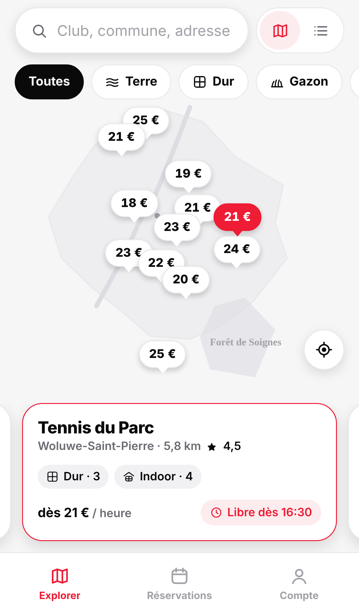
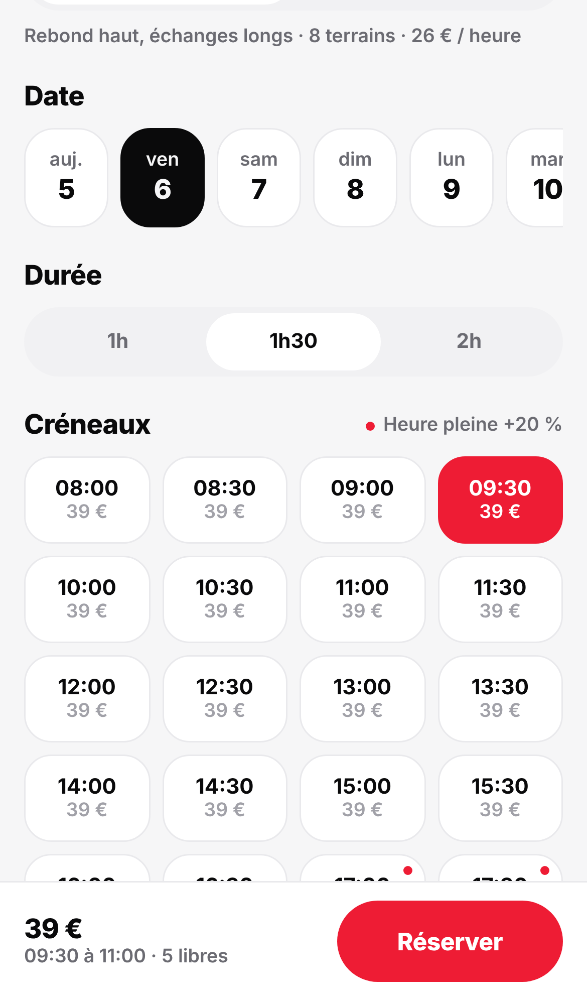
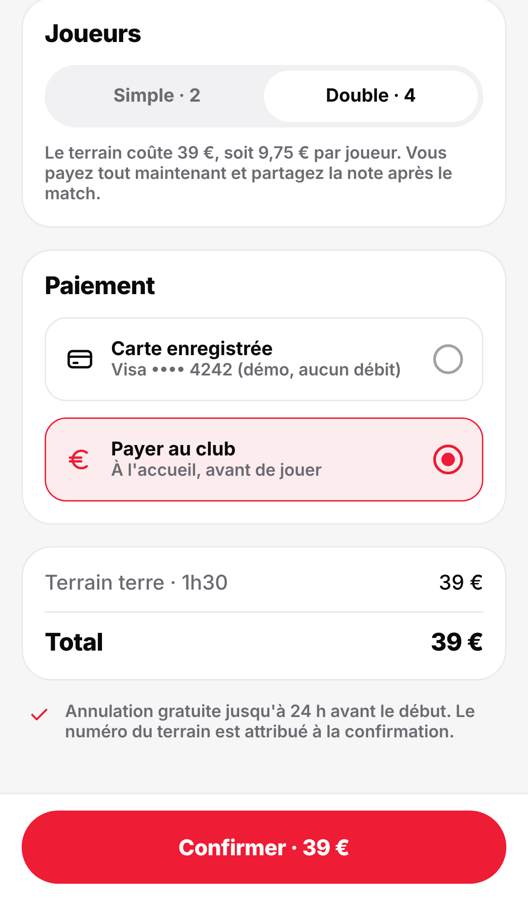
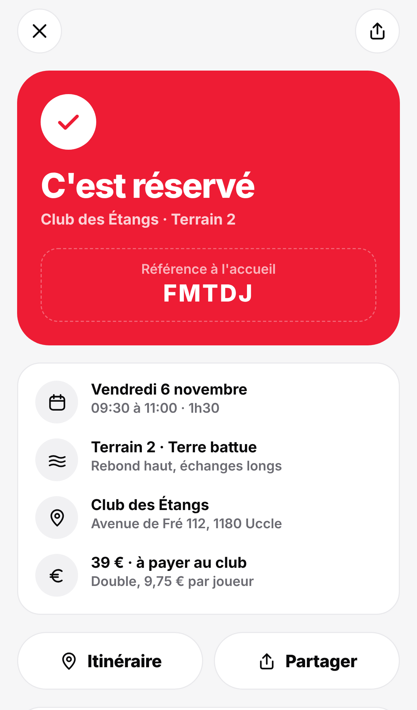
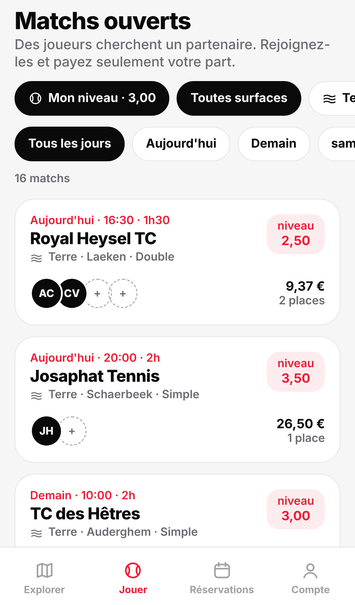
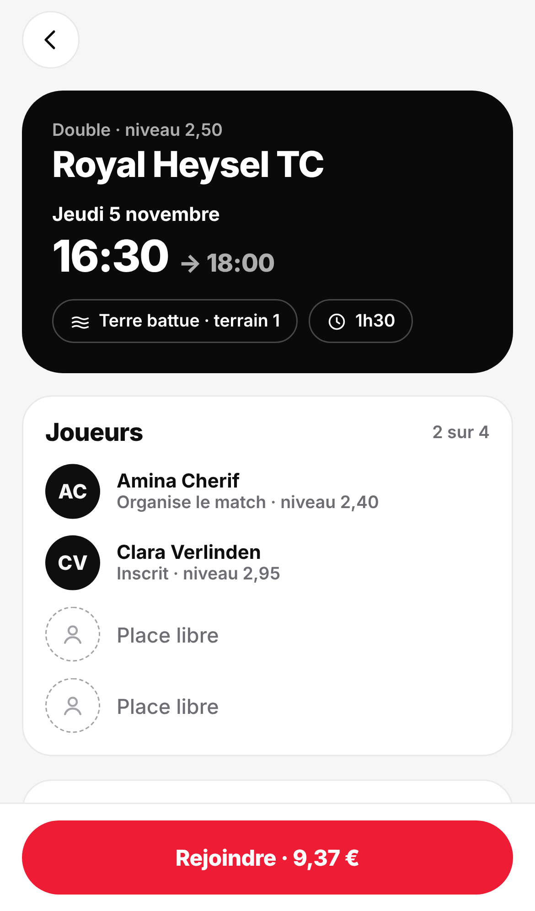
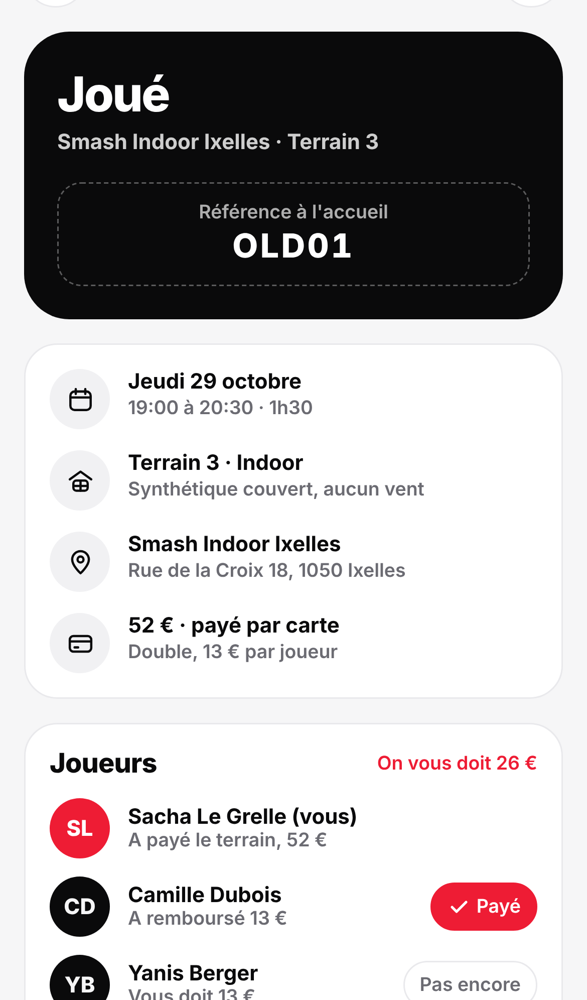

# Courtside mobile

Application mobile native de réservation de terrains de tennis à Bruxelles, en TypeScript avec React Native et Expo (SDK 58). Elle reprend l'identité de la v2 web (blanc, rouge, noir, mode sombre) et la porte sur iOS et Android.

| Carte | Club | Récapitulatif | Confirmation |
|---|---|---|---|
|  |  |  |  |

| Matchs ouverts | Match | Partage de la note |
|---|---|---|
|  |  |  |

## Lancer

```
cd mobile
npm install
npx expo start
```

Puis scanner le QR code avec Expo Go (iOS ou Android). `npx expo start --web` ouvre la version navigateur.

## Parcours

1. **Explorer** : carte des 12 clubs avec le prix d'appel sur chaque épingle, carrousel de fiches synchronisé avec la carte, ou liste triable par distance, prix ou note. Recherche par nom, commune ou adresse (sans tenir compte des accents), filtre par surface et par favoris. Le bouton de position trie par distance réelle, sinon les distances partent de la Grand-Place.
   En mode liste, un bandeau rappelle le prochain match.
2. **Club** : surface (terre battue, dur, gazon, indoor), 14 jours avec sous chaque date une barre qui montre la part de créneaux encore libres, durée de 1h, 1h30 ou 2h, puis grille de créneaux par demi-heure avec prix et nombre de terrains libres. Heures pleines (soirs de semaine, matins de week-end) à +20 %.
3. **Récapitulatif** : simple ou double avec la part par joueur, paiement par carte (fictif) ou au club, conditions d'annulation. Sans compte, le bouton ouvre la connexion puis revient ici.
4. **Confirmation** : numéro de terrain attribué, référence à donner à l'accueil, partage par le menu natif, itinéraire.
5. **Jouer** : matchs ouverts publiés par d'autres joueurs sur les 7 prochains jours, filtrés par niveau (à 0,75 près du vôtre), surface et jour. La fiche d'un match montre les inscrits, leur niveau, les places libres et votre part. Rejoindre crée la réservation, se désister rend la place.
6. **Réservations** : à venir et historique. Annulation gratuite jusqu'à 24 h avant, ensuite l'app propose d'appeler le club. Sur une réservation payée par carte, on nomme les partenaires, on coche qui a remboursé sa part et on relance les retardataires par le menu de partage. Depuis l'historique, « Rejouer au même créneau » rouvre le club sur le même jour de la semaine suivante, à la même heure.
7. **Compte** : inscription et connexion locales, niveau, surface préférée (présélectionnée sur les fiches club), statistiques, montant que vos partenaires vous doivent, clubs favoris, déconnexion, effacement des données.

## Règles métier

- Les réservations des autres joueurs sont simulées par un hachage déterministe du club, du terrain, du jour et de l'heure, avec une demande plus forte aux heures pleines. La grille est donc stable d'un lancement à l'autre.
- Toute réservation faite sur le téléphone bloque son terrain, quel que soit le compte.
- Impossible de réserver deux créneaux qui se chevauchent, même dans deux clubs différents.
- Un créneau doit commencer au moins 15 minutes plus tard. À minuit, la fiche club repasse d'elle-même au jour courant.
- Les matchs ouverts sont générés de la même façon, à partir d'un hachage du jour, avec 20 joueurs fictifs et leur niveau de 1,00 à 7,00. Les niveaux déclarés valent 1,75 (débutant), 3,00 (intermédiaire), 4,50 (confirmé) et 6,00 (compétition).
- Les dates sont formatées à la main en français, parce que Hermes sur Android n'embarque pas toutes les données `Intl`.

## Technique

- Expo Router (`src/app/`) : onglets Explorer, Réservations, Compte, plus les écrans club, récapitulatif, réservation et connexion.
- État dans un contexte React persisté avec AsyncStorage (`src/state/store.tsx`).
- Logique pure et testée dans `src/lib/` : catalogue, disponibilités, prix, annulation, dates, distances, validation du formulaire.
- Carte native avec `react-native-maps` (Apple Plans sur iOS, Google Maps sur Android). Sur le web, `ClubMap.web.tsx` dessine un plan schématique de la Région bruxelloise, parce que `react-native-maps` ne tourne pas dans un navigateur.
- Icônes en SVG (`react-native-svg`), mêmes tracés que la v2.
- Entrées en cascade avec l'API `Animated` (désactivées si le système demande moins d'animations), retour haptique sur les créneaux, les paiements et les confirmations.

## Vérifier

```
npm run typecheck
npm test
npx expo export --platform ios
```

## Limites

C'est une démonstration. Clubs, tarifs et disponibilités sont fictifs (les communes et coordonnées sont réelles), le paiement n'est pas branché, et le compte reste sur le téléphone sans mot de passe stocké. Pour un build Android autonome (hors Expo Go), Google Maps demande une clé API dans `app.json`.
